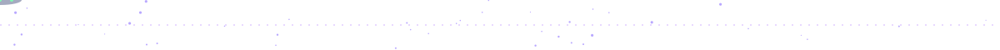

  

<!-- wisdom:start -->
<!-- wisdom:end -->

### 👽 Equipment on board

  
  
  
  
  
  
  
  

<!-- calendar:start -->
<!-- calendar:end -->

📡 Transmission ends. The truth is out there, probably in the logs.

